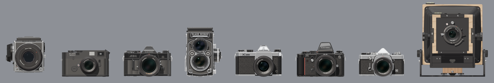

# GlassWorks Cameras

**Museum-grade, 100% procedural Three.js 3D film camera and lens models** — authored entirely in millimeter-scale JavaScript with exact thin-lens optical mathematics, operational hollow interiors, animated mechanical cycles, an automated headless WebGL audit harness, and cross-agent skills for building new cameras.



> **Zero external meshes. Zero downloaded textures.** Every camera body, bayonet mount, glass meniscus, knurled dial, engraved scale, leatherette grain, shutter curtain, bellows fold, and film spool is generated procedurally in Three.js from millimeter engineering specifications.

---

## Collection: 8 Cameras · 53 Lenses

Every camera has a live interactive 3D page on **[glass-works.ai/cameras](https://glass-works.ai/cameras)** and a feature-by-feature walkthrough film on **[YouTube](https://www.youtube.com/channel/UCVORaoFOBp_ef_Cbsfxy1cw)**.

| Camera | System & Era | Format | Shutter | Lenses | Key Interactive & Optical Features | Links |
| :--- | :--- | :--- | :--- | :---: | :--- | :--- |
| **Hasselblad 503CX** | Hasselblad V (`503cx`) | 6×6 (120) | Prontor CF Leaf (`1s–1/500, B`) | **11** | Folding waist-level hood & 4.5× magnifier, detachable A12 magazine & dark slide, full V-system interlock state machine, 30–500 mm CF lenses, optical cutaway & exploded view | [Watch (10:05)](https://www.youtube.com/watch?v=4mqvJiATaFQ) · [Live](https://glass-works.ai/cameras/503cx) · [SPEC](src/cameras/503cx/SPEC.md) |
| **Leica M6** | Leica M (`m6`) | 24×36 (135) | Horizontal Cloth FP (`1s–1/1000, B`) | **6** | Early Wetzlar black chrome, 0.72× rangefinder window & frame-selector lever, angled rewind crank, removable baseplate & rear swing door, 28–135 mm M lenses w/ RF cam | [Watch (6:25)](https://www.youtube.com/watch?v=eanvkOnrIus) · [Live](https://glass-works.ai/cameras/m6) · [SPEC](src/cameras/m6/SPEC.md) |
| **Intrepid 4×5 Mk5** | Large Format (`intrepid`) | 4×5 Sheet | Copal No. 0 / No. 1 Leaf (`1s–1/500, B, T`) | **6** | Birch ply & aluminum standards, live procedural pleated bellows, rise/fall/shift/tilt/swing movements, dark cloth & 6× focusing loupe, Fidelity film holder, 75–300 mm LF lenses | [Watch (6:48)](https://www.youtube.com/watch?v=tnyMEkXDYko) · [Live](https://glass-works.ai/cameras/4x5) · [SPEC](src/cameras/intrepid/SPEC.md) |
| **Canon AE-1** | Canon FD (`ae1`) | 24×36 (135) | Electronic Cloth FP (`2s–1/1000, B`) | **6** | 1976 black-enamel SLR, breech-lock FD S.S.C. lenses w/ green AE-lock collars, magnetic shutter release, open-back 35 mm film path, battery door, 24–135 mm primes | [Watch (6:25)](https://www.youtube.com/watch?v=fuwGDFB_XOQ) · [Live](https://glass-works.ai/cameras/ae1) · [SPEC](src/cameras/ae1/SPEC.md) |
| **Rolleiflex 2.8F** | Bay III TLR (`rolleiflex`) | 6×6 (120) | Synchro-Compur MXV Leaf (`1s–1/500, B`) | **4** | Twin-lens taking/viewing optical stack, folding WLF hood w/ sports finder, coupled exposure-meter needle, crank-driven 120 film path, 80 mm Planar + Bay III Rolleinar 1/2/3 | [Watch (6:40)](https://www.youtube.com/watch?v=OzMtAHzkzgI) · [Live](https://glass-works.ai/cameras/28f) · [SPEC](src/cameras/rolleiflex/SPEC.md) |
| **Pentax K1000** | Pentax K (`k1000`) | 24×36 (135) | Mechanical Cloth FP (`1s–1/1000, B`) | **6** | 1976 Asahi satin-chrome student SLR, deep-drawn brass top deck, bare-metal bead-blasted chrome & jet vulcanite, open-back film loading, 28–135 mm SMC-M primes | [Watch (6:24)](https://www.youtube.com/watch?v=V1DBchb3J84) · [Live](https://glass-works.ai/cameras/k1000) · [SPEC](src/cameras/k1000/SPEC.md) |
| **Nikon F3HP** | Nikon F (`f3`) | 24×36 (135) | Quartz Titanium FP (`8s–1/2000, B, T`) | **7** | 1982 Giugiaro design, removable DE-3 High-Eyepoint pentaprism, quilted titanium focal-plane curtains, red grip stripe, 24–135 mm AI-S Nikkor primes | [Watch (6:34)](https://www.youtube.com/watch?v=ibVzw6qadRM) · [Live](https://glass-works.ai/cameras/f3) · [SPEC](src/cameras/f3/SPEC.md) |
| **Olympus OM-1 MD** | Olympus OM (`om1`) | 24×36 (135) | Concentric Cloth FP (`1s–1/1000, B`) | **7** | 1976 Yoshihisa Maitani ultra-compact satin-chrome SLR, iconic lens-mount concentric shutter ring, machined scalloped all-metal Zuiko primes (24–135 mm) | [Watch (6:42)](https://www.youtube.com/watch?v=yW2Q9XXwHR4) · [Live](https://glass-works.ai/cameras/om1) · [SPEC](src/cameras/om1/SPEC.md) |

---

## Feature-by-Feature Camera Films

Watch all eight cameras in action — animated controls, lens swaps, open film paths, shutter cycles, and optical cutaways — on the **[GlassWorks YouTube channel](https://www.youtube.com/channel/UCVORaoFOBp_ef_Cbsfxy1cw)**:

<table>
  <tr>
    <td align="center" width="25%">
      <a href="https://www.youtube.com/watch?v=4mqvJiATaFQ">
        <br>
        <strong>The 503CX</strong> (10:05)
      </a>
    </td>
    <td align="center" width="25%">
      <a href="https://www.youtube.com/watch?v=eanvkOnrIus">
        <br>
        <strong>The M6</strong> (6:25)
      </a>
    </td>
    <td align="center" width="25%">
      <a href="https://www.youtube.com/watch?v=tnyMEkXDYko">
        <br>
        <strong>The 4×5 Field</strong> (6:48)
      </a>
    </td>
    <td align="center" width="25%">
      <a href="https://www.youtube.com/watch?v=fuwGDFB_XOQ">
        <br>
        <strong>The AE-1</strong> (6:25)
      </a>
    </td>
  </tr>
  <tr>
    <td align="center" width="25%">
      <a href="https://www.youtube.com/watch?v=OzMtAHzkzgI">
        <br>
        <strong>The 2.8F</strong> (6:40)
      </a>
    </td>
    <td align="center" width="25%">
      <a href="https://www.youtube.com/watch?v=V1DBchb3J84">
        <br>
        <strong>The K1000</strong> (6:24)
      </a>
    </td>
    <td align="center" width="25%">
      <a href="https://www.youtube.com/watch?v=ibVzw6qadRM">
        <br>
        <strong>The F3HP</strong> (6:34)
      </a>
    </td>
    <td align="center" width="25%">
      <a href="https://www.youtube.com/watch?v=yW2Q9XXwHR4">
        <br>
        <strong>The OM-1 MD</strong> (6:42)
      </a>
    </td>
  </tr>
</table>

---

## Built with Gemini 4 Neon

The bulk of this collection — including the multi-camera procedural CAD architecture, deep-drawn brass & bare-metal PBR pipeline, all 53 individually sculpted lenses, exact thin-lens optical prescriptions, automated WebGL veto harness, and adversarial critique rubric — was designed, engineered, and iteratively refined using **Gemini 4 Neon**.

We package the exact **cross-agent skills** and **8-stage playbook** directly inside this repository so anyone can use Gemini (or any agent supporting `AGENTS.md` and `SKILL.md`) to build and verify new museum-grade cameras to the same standard:

- **[`skills/camera-builder/SKILL.md`](skills/camera-builder/SKILL.md)** — Enforces the 8-stage workflow and 30 engineering laws in [`docs/PLAYBOOK.md`](docs/PLAYBOOK.md) (sub-mm spec lock, exact analytical helicoid extension `<= 0.0005 mm`, curved CAD lofts, dual-end machined knurling, flat-black hollow interiors, 3D rear bayonets, and lazy cutaways).
- **[`skills/camera-critic/SKILL.md`](skills/camera-critic/SKILL.md)** — Runs an adversarial, zero-trust audit enforcing the 7 Hard Veto Gates (`V1`–`V7`, including open-gate optical raycasts) and a 100-point rubric in [`docs/CRITIC.md`](docs/CRITIC.md) requiring `>= 96 / 100` (`APPROVED — DELIGHTED`) before sign-off.
- **[`AGENTS.md`](AGENTS.md)** — Universal cross-agent entry point so any AI coding agent picks up the workflow automatically.

---

## Quick Start

### 1. Run the Interactive 3D Studio Viewer

```bash
git clone https://github.com/TrondW/glassworks-cameras.git
cd glassworks-cameras
npm install
npm run dev
```

Open **http://127.0.0.1:4173/viewer/** to orbit all 8 cameras, swap any of the 53 lenses, open backs, load film, toggle optical cutaways and exploded views, and fire shutters live in WebGL.

### 2. Use Programmatically in Three.js

```js
import * as THREE from 'three';
import { CAMERAS, createCamera, flushCameraTextures } from 'glassworks-cameras';

const cam = await createCamera('f3', {
  lens: CAMERAS.f3.lenses.find((l) => l.id === 'ais-105-2.5'),
});

// `cam.root` mounts the camera on its carbon tripod at metre scale;
// `cam.parts.mm` is the camera body itself in native millimetres.
scene.add(cam.root);
camera.layers.enable(1); // Camera meshes live on layer 1 (isolated from taking-lens cameras)

cam.setState({ focus: 2.5, aperture: 2.5, shutterIdx: 11, frame: 12, film: { iso: 400 } });
cam.update(0.016);
flushCameraTextures();
```

See **[`docs/CONTRACT.md`](docs/CONTRACT.md)** for the full runtime API (`setAim`, `swapLens`, `setHood`, `setFilter`, `setCutaway`, `setExploded`, `setFilmLoaded`, `fire`, `pickables`, `labelAt`).

### 3. Run the Automated Headless WebGL Audit

Requires Node `>= 20`, Chrome or Chromium (auto-detected on macOS/Linux/Windows or via `CHROME_PATH`), and Python 3 + Pillow (`pip install pillow`) for plate composition:

```bash
# Audit one camera + generate the 5-plate Visual Evidence Pack + 1:1 lineup
npm run audit -- --camera om1 --out .audit-out/om1 --lineup

# Fast runtime, optical math, layer-1, open-gate raycast & static lint gate across all 8 cameras
npm run audit:quick

# Full 5-plate audit across all 8 cameras
npm run audit:all
```

Every camera must pass **`[MACHINE_PASS]`** with **`0` vetoes** and **`0` warnings**:
- **V1**: Zero runtime/WebGL errors, full `CONTRACT.md` API, Layer-1 isolation (`mask === 2`), `setAim()` tripod articulation.
- **V2**: Zero `transmission > 0` materials (uses custom multi-coated `LENS_GLASS_GLSL`).
- **V3**: Analytical thin-lens helicoid extension error `<= 0.0005 mm`, `s_min > 4·f_cal`, zero fallback optics.
- **V5**: Parallel dual-end knurling (`segs >= 6·n`), `ringAxisWorld()` transform, local-origin glass shader, mid-cutaway lens-swap sync, and **dual-direction open-gate optical raycast (`V5(gate-clear)`)** verifying zero geometry blocks the mirror-up/open-curtain/open-back film path.
- **V6**: Dead-flat anti-reflection interior black (`roughness >= 0.85`, `specularIntensity <= 0.05`, `envMapIntensity <= 0.15`) and bare-metal chrome checks.
- **V7**: Wide legible front lens beauty rings (`>= 2.2 mm`), 3D rear bayonets on every interchangeable lens, and envelope tolerances.

---

## Repository Structure

```text
glassworks-cameras/
├── src/
│   ├── index.js               # Public ESM package entry point
│   ├── cameras.js             # Camera registry, viewing adapters & lazy loader
│   ├── optics.js              # Pure lens-optics registry, thin-lens math, DoF & filters
│   ├── formats.js             # Film formats (135, 6×6, 4×5)
│   ├── shutters.js            # Leaf & focal-plane shutter speed specifications
│   ├── mechanisms/            # Hand-worked mechanical interlock state machines
│   ├── lib/                   # Shared procedural CAD engine (geometry, PBR, engraving, decals, tripod)
│   └── cameras/<kind>/        # Self-contained folder per camera (index.js, lenses.js, SPEC.md)
├── viewer/                    # Lean interactive studio viewer & deterministic audit harness
├── skills/                    # Cross-agent skills (camera-builder & camera-critic)
├── docs/                      # PLAYBOOK.md (30 Laws), CRITIC.md (Rubric), CONTRACT.md (API)
├── scripts/                   # dev-server.mjs, camera-audit.mjs, cross-platform chrome.mjs
└── .github/                   # Automated WebGL CI workflow & PR/issue templates
```

---

## Contributing

Want to add a Nikon FM2n, Pentax Spotmatic, Mamiya 7, Contax G2, or Leica IIIf? Every camera lives in its own isolated folder under `src/cameras/<kind>/`. Read **[`CONTRIBUTING.md`](CONTRIBUTING.md)** and **[`docs/PLAYBOOK.md`](docs/PLAYBOOK.md)** to get started!

## License & Neutral Marks

Licensed under the **[MIT License](LICENSE)**.

All models are original procedural geometric works created for optical and mechanical education. Neutral `GLASS WORKS` / `GW` legends appear where manufacturer trademarks sit on historic hardware, and no third-party photographs, manuals, or copyrighted assets are distributed in this repository.
